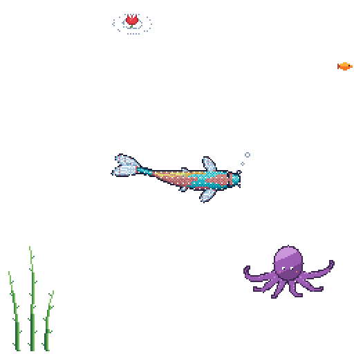

<p align="center">
  
  <br/>
  <sub>🐟 my koi: grows when I code, rests when I don't, and shares its tank with an octopus</sub>
</p>

# Hi, I'm Enise!
- > [Linkedin](https://www.linkedin.com/in/eniseirem/) [Medium](https://medium.com/@eniseirem) [Website](https://eniseirem.github.io/)

>"Talk is cheap. Show me the code."

> Welcome to my GitHub. Here’s a playful look at me, via some pseudo-Python:

```python
class Enise:
    title    = "Machine Learning Engineer"
    base     = "Berlin"
    now      = "Explainable AI research @ Fraunhofer HHI"
    before   = "4+ years of anomaly detection & forecasting @ Vakıfbank"
    studying = "M.Sc. Data Science @ FU Berlin"
    stack    = ["Python", "PyTorch", "TensorFlow", "Scikit-learn", "SQL"]
    curious  = ["Interpretable ML", "LLM alignment", "Computer Vision"]
    learning = "German 🥨 (A2)"
```
*Disclaimer: This code won't compile — but my curiosity does.
inspiration : [ashbakernz](https://github.com/ashbakernz) · koi : my turquoise fork of [git-koi](https://github.com/yalongwastaken/git-koi)*
